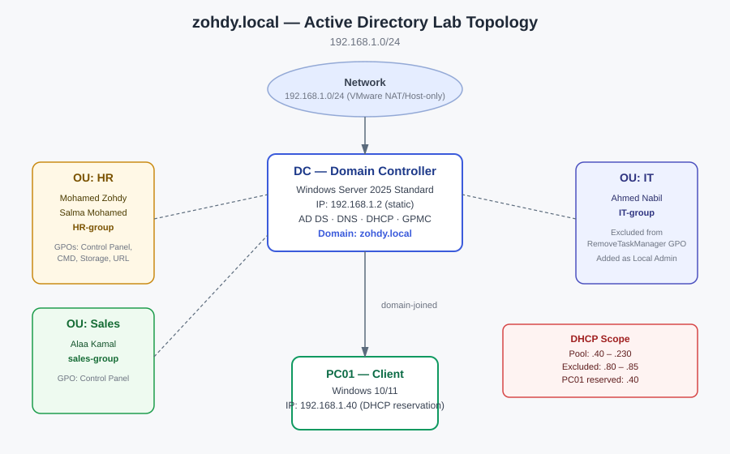
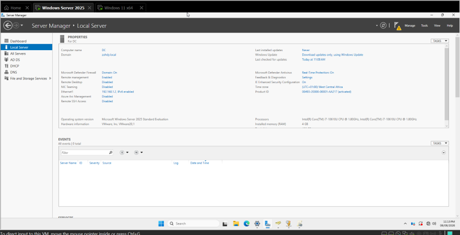
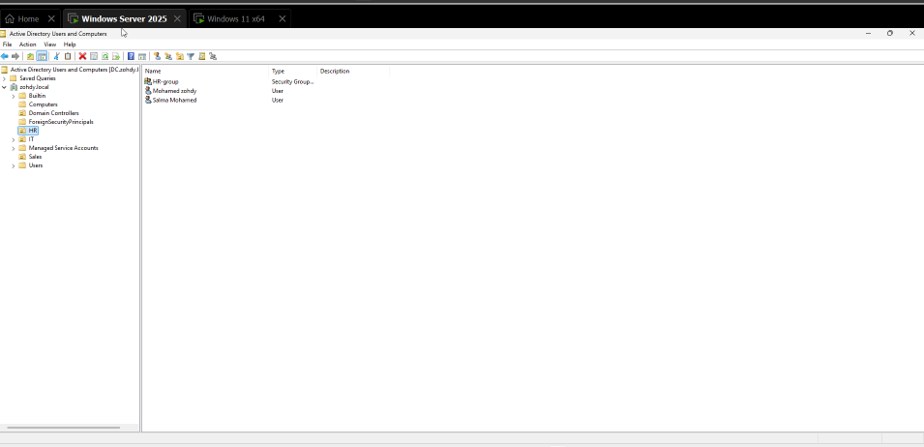
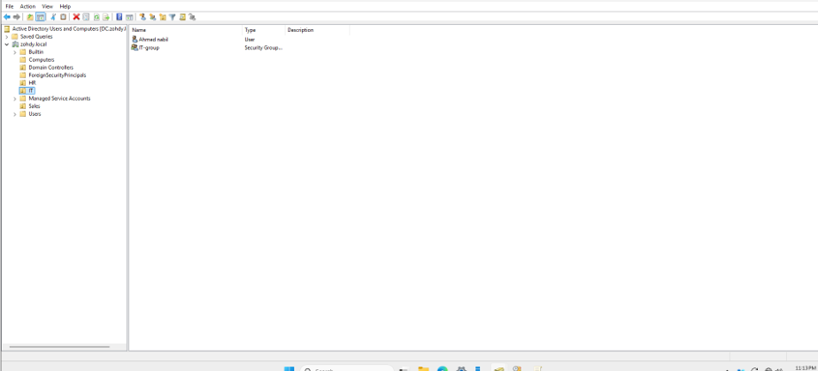
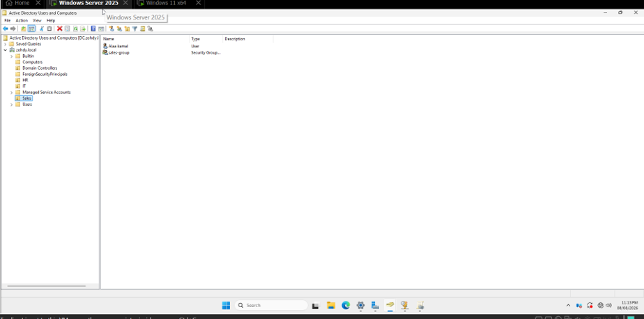
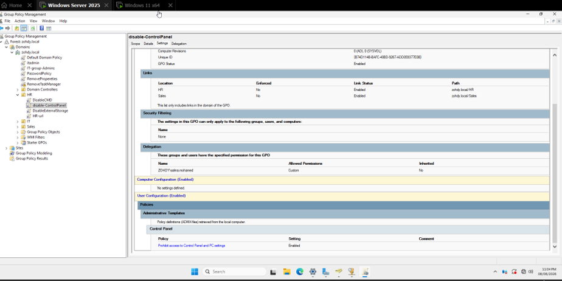
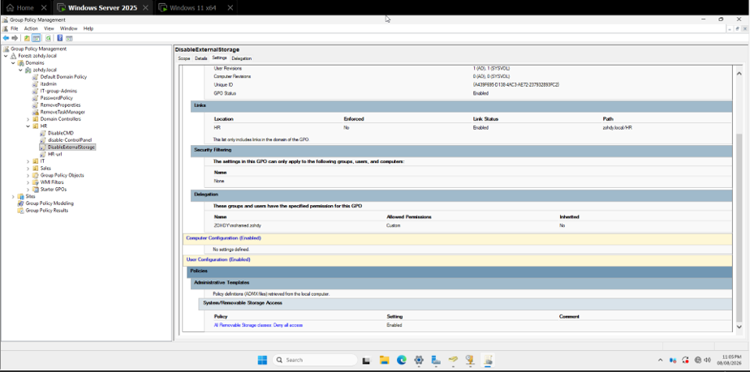
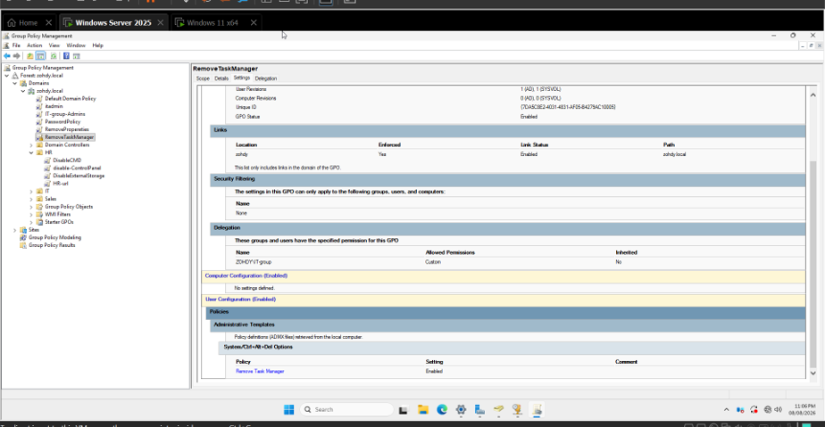
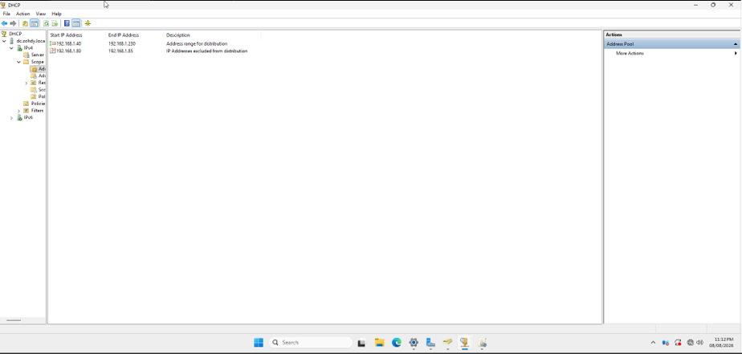
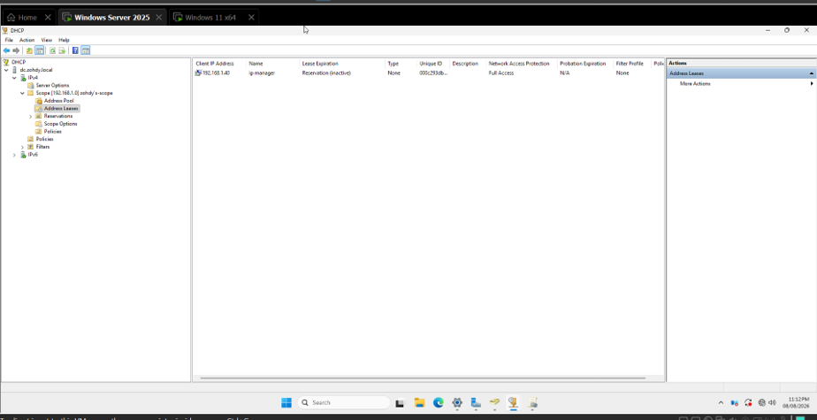

# Active Directory Domain Lab — zohdy.local

A hands-on Windows Server lab where I built a small but complete Active
Directory environment from scratch: domain setup, OU structure, users and
groups, Group Policy Objects for real-world scenarios, DHCP, and a
domain-joined client — all inside VMware Workstation, configured through the
GUI tools (Server Manager, ADUC, GPMC, DHCP console).

This isn't a tutorial walkthrough. It's a self-assigned lab designed to
mimic a small company's IT environment, with the kind of messy, specific
requirements (exclude one manager from a restriction, scope a GPO to one
department, lock down the whole domain except IT) that show up in real
sysadmin work.

## Architecture



| Role | Hostname | IP | OS |
|---|---|---|---|
| Domain Controller (AD DS, DNS, DHCP) | DC | 192.168.1.2 (static) | Windows Server 2025 Standard (Evaluation) |
| Domain-joined client | PC01 | 192.168.1.40 (reserved via DHCP) | Windows 11 |

**Domain:** `zohdy.local`

## Prerequisites

| Item | Suggested |
|---|---|
| Host | 16 GB RAM (8 GB minimum), 4+ cores, ~80 GB free disk |
| Hypervisor | VMware Workstation |
| VMs | DC: 2 vCPU / 4 GB RAM / 60 GB disk. Client: 2 vCPU / 4 GB RAM / 60 GB disk |
| ISOs | Windows Server 2025 Evaluation and a Windows 11 ISO (Microsoft Evaluation Center) |
| Network | One isolated virtual network, `192.168.1.0/24`. If VMware's built-in DHCP is enabled on it, turn it off so it doesn't compete with the DC's DHCP server. |

## Repository layout

```
.
├── README.md
├── LICENSE
├── .gitignore
├── docs/
│   ├── network-diagram.svg
│   └── setup-notes.md          # step-by-step notes + troubleshooting log
└── screenshots/                # PNG files, numbered in build order (01 – 10)
```

## Build order

Details for every step are in [`docs/setup-notes.md`](documents/setup-notes.md).

1. DC: install Server 2025, static IP, rename to `DC`, install AD DS, promote to new forest `zohdy.local`
2. Create OUs, users and security groups
3. Install DHCP, create the scope, exclusion range, authorize it, then add PC01's reservation
4. Install the client VM, point its DNS at the DC, join it to the domain
5. Create and link the GPOs, then set security filtering where needed
6. Configure password/lockout policy and the local-admin settings
7. Verify with `dcdiag`, `nltest`, `gpresult`, and manual tests per user

## OU & User Structure

```
zohdy.local
├── HR
│   ├── Mohamed Zohdy          (user — HR manager, excluded from storage lockdown)
│   ├── Salma Mohamed          (user)
│   └── HR-group               (security group)
├── Sales
│   ├── Alaa Kamal              (user)
│   └── sales-group             (security group)
└── IT
    ├── Ahmed Nabil              (user)
    └── IT-group                 (security group)
```

## Group Policy Objects

| GPO | Scope | What it does |
|---|---|---|
| `disable-ControlPanel` | HR, Sales OUs | Hides/disables Control Panel |
| `DisableCMD` | HR OU | Disables `cmd.exe` |
| `DisableExternalStorage` | HR OU (security-filtered to exclude HR manager) | Blocks USB/removable storage for all HR users except Mohamed Zohdy |
| `RemoveTaskManager` | Domain root, link enforced (exception for IT-group) | Removes Task Manager for domain users except IT |
| `RemoveProperteies` | Domain root | Removes "Properties" from the This PC right-click context menu |
| `PasswordPolicy` | Domain root | History 2, max age 90 days, min age 30 days, min length 6, complexity on; lockout after 5 attempts for 60 minutes, counter reset after 10 minutes |
| `HR-url` | HR OU | Deploys the `http://hrapp.zohdy.local` shortcut to HR desktops (GPP) |
| `itadmin` | Domain root | Creates a local admin account (`itadmin`) on domain-joined computers via GPP |
| `IT-group-Admins` | Domain root | Adds `IT-group` to the local Administrators group via GPP |

### How "everyone except X" works

I used security filtering instead of moving exceptions into a separate OU,
because pulling one user (the HR manager) or one group (IT) out of its
department OU would break the department-based structure for no real benefit.

In the GPMC, filtering has two parts that both matter:

- Add the group that should get the policy under **Scope → Security Filtering**.
- Add the exception as an explicit **Deny → Apply group policy** entry under **Delegation → Advanced**. A missing Allow isn't enough when Authenticated Users still has Apply.

Best practice is to keep **Read** for Authenticated Users on filtered GPOs, since removing it entirely can stop the GPO from applying to anyone (MS16-072). See the limitations section for what my screenshots show.

## DHCP Configuration

- Scope: `192.168.1.0/24` ("zohdy's-scope")
- Address pool: `192.168.1.40` – `192.168.1.230`
- Exclusion range: `192.168.1.80` – `192.168.1.85`
- `PC01` receives `192.168.1.40` via a **DHCP reservation** (named `ip manager` in the console) tied to its MAC address, so it always gets the same address without a static IP on the client and without the pool handing that address to someone else.
- The DHCP server is authorized in AD (an unauthorized server won't lease addresses on a domain network).

## Testing

Each restriction was tested on PC01 as an affected user and as an excluded one, and `gpresult /h report.html` confirmed which GPOs applied.

| # | Test | Account | Expected | Result |
|---|---|---|---|---|
| 1 | Open Control Panel | salma.mohamed (HR) | Blocked | ✅ |
| 2 | Open Control Panel | alaa.kamal (Sales) | Blocked | ✅ |
| 3 | Open Control Panel | ahmed.nabil (IT) | Allowed | ✅ |
| 4 | Run `cmd.exe` | salma.mohamed | Blocked | ✅ |
| 5 | Insert USB drive | salma.mohamed | Blocked | ✅ |
| 6 | Insert USB drive | mohamed.zohdy (HR manager) | Allowed | ✅ |
| 7 | Open Task Manager | alaa.kamal | Blocked | ✅ |
| 8 | Open Task Manager | ahmed.nabil (IT) | Allowed | ✅ |
| 9 | This PC → right-click | salma.mohamed | No "Properties" | ✅ |
| 10 | HR desktop shortcut | salma.mohamed | Present | ✅ |
| 11 | 6 wrong passwords | a test user | Locked out for 60 min | ✅ |

## What I Learned / Troubleshooting

- **Recurring NETLOGON Event ID 5781 warnings.** Traced this to a DNS registration issue for the DC's SRV records. Fixed by verifying only one active NIC was registering in DNS, running `ipconfig /registerdns`, and confirming clean output from `dcdiag /test:dns`.
- **DHCP pool vs. reserved client IP.** The pool's starting address overlapped with PC01's intended static IP. Instead of hard-coding a static IP on the client, I created a DHCP reservation tied to PC01's MAC address: a good example of reservations vs. exclusions vs. static configuration.
- **Password policy can't be scoped to an OU with a normal GPO.** Domain account policies (password, lockout) only take effect from a GPO linked at the **domain root**; linked to an OU, they're ignored. Per-group policies need **Fine-Grained Password Policies (PSOs)**, which apply to **users and global security groups** (not OUs). The lab asked for one domain-wide policy, so the domain root was correct.

## Known limitations / what I'd do differently

- **Security filtering and delegation.** In the GPMC Settings reports (screenshots 05–07), *Security Filtering* reads "None" and *Delegation* lists a single principal, meaning the default entries (Authenticated Users, Domain Admins, SYSTEM) were removed from those GPOs. The recommended setup keeps Read for Authenticated Users and grants Apply to the target group; a cleaner version of this lab would show that in the Scope and Delegation tabs.
- **PasswordPolicy vs. Default Domain Policy.** Both exist at the domain root. Whichever has the higher link order wins for conflicting account-policy settings, so one policy should own these settings.
- **Preset local-admin password via GPP.** The `itadmin` account was created with Group Policy Preferences. GPP stores that password in SYSVOL with a publicly known key (MS14-025), so any domain user could recover it, and current Windows versions disable the password field. Fine for an isolated lab, not for production. The proper fix is **Windows LAPS** (on the roadmap).
- **Password policy.** Min length 6 and history 2 come from the exam scenario. Real environments should use 12+ characters.
- **Computers container.** PC01 sits in the default `Computers` container. A dedicated `Workstations` OU would allow computer-side GPOs (LAPS, local admin groups) to be scoped properly.
- **Removable storage policy.** It exists under both Computer and User Configuration. Filtering by a user or group only works with the **User Configuration** version.
- **GPO name typo.** `RemoveProperteies` could be renamed to `RemoveProperties`.

## Screenshots

Numbered in build order (all files are in [`/screenshots`](screenshots)).

**1. Domain controller — Server Manager** (`DC`, `zohdy.local`, `192.168.1.2`, Server 2025 Standard Evaluation)



**2. OU `HR`** — Mohamed zohdy, Salma Mohamed, `HR-group`



**3. OU `IT`** — Ahmed nabil, `IT-group`



**4. OU `Sales`** — Alaa kamal, `sales-group`



**5. GPO `disable-ControlPanel`** — linked to HR and Sales, "Prohibit access to Control Panel and PC settings" enabled



**6. GPO `DisableExternalStorage`** — linked to HR, "All Removable Storage classes: Deny all access" (User Configuration)



**7. GPO `RemoveTaskManager`** — linked at the domain root, "Remove Task Manager" enabled



**8. DHCP address pool** — range `.40 – .230`, exclusion `.80 – .85`



**9. DHCP reservation** — `192.168.1.40` reserved in `zohdy's-scope`



**10. `PasswordPolicy` GPO** — password and lockout settings


## Technologies

Windows Server 2025 (Standard, Evaluation) · AD DS · DNS · DHCP · Group Policy (GPMC + GPP) · Windows 11 client · VMware Workstation

## Roadmap — Bigger Version (planned)

- [ ] Second domain controller + replication (DFSR/SYSVOL, Sites & Services)
- [ ] Automate the build with PowerShell (`New-ADUser`, `New-GPO`, `Add-DhcpServerv4Scope`, ...)
- [ ] File server with NTFS + share permissions, DFS Namespace, folder redirection GPO
- [ ] Fine-Grained Password Policies (PSOs) per department
- [ ] Windows LAPS replacing the static `itadmin` local admin account
- [ ] Dedicated `Workstations` OU for computer-side policies
- [ ] AD Certificate Services (lightweight internal PKI)
- [ ] Linux client joined to the domain via SSSD/realmd
- [ ] Centralized logging via Windows Event Forwarding

---

*Lab based on a self-assigned exam scenario. All usernames, IPs, and domain names are lab-only and not tied to any real organization.*
